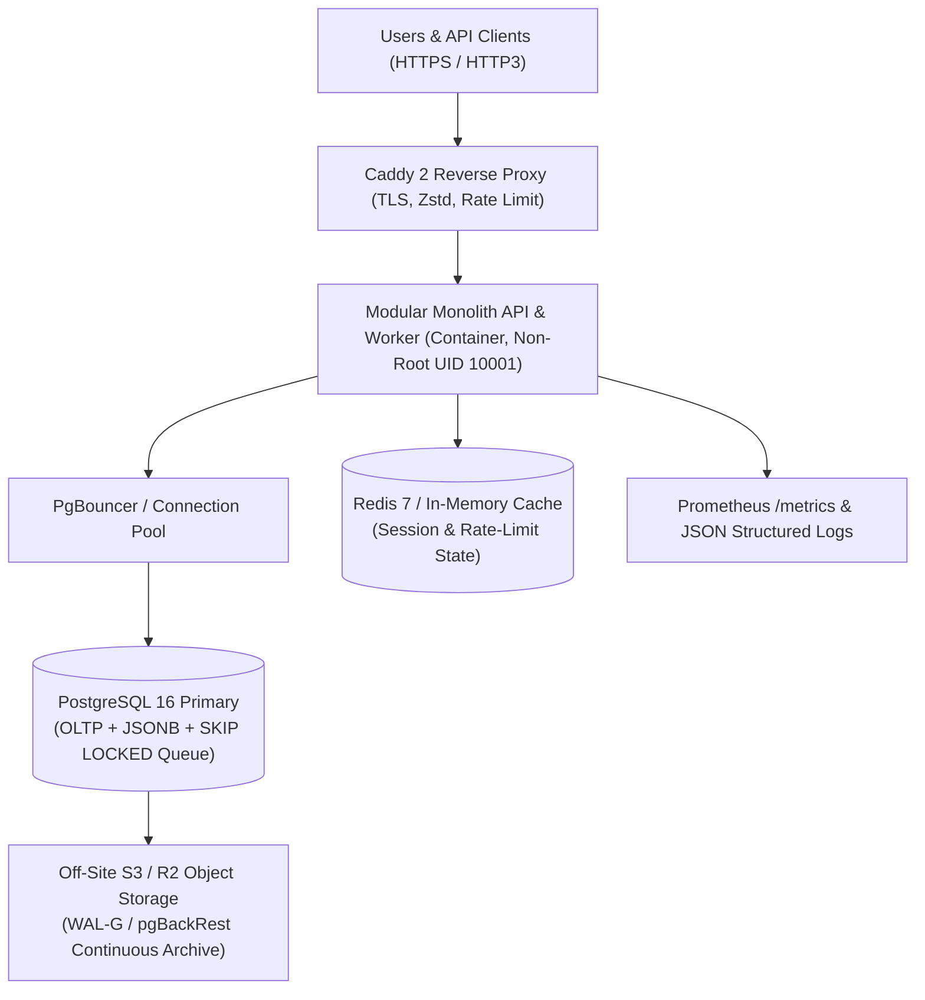

# System Architecture & Day-0 Engineering Blueprint (`stack-architect` / `ship-blueprint`)

## 1. Requirements Summary
- **Product Type / Complexity**: `b2b_developer_saas` (`medium`)
- **Traffic**: `150 avg RPS` (`800 concurrent users`, Read/Write `85:15`)
- **Latency / Availability Targets**: `p95 <= 120 ms` | `SLA: 99.9%` | `RPO: 15m` | `RTO: 30m`
- **Budget & Team**: `$120.0/month` | `Team Size: 2` (`go_typescript_postgres`)

## 2. Assumptions Register

| Field | Value | Source | Rationale |
| :--- | :--- | :--- | :--- |
| `product_type` | `b2b_developer_saas` | `user_provided` | Explicitly provided in constraints specification. |
| `product_complexity` | `medium` | `user_provided` | Explicitly provided in constraints specification. |
| `expected_concurrent_users` | `800` | `user_provided` | Explicitly provided in constraints specification. |
| `expected_rps` | `150` | `user_provided` | Explicitly provided in constraints specification. |
| `read_write_ratio` | `85:15` | `user_provided` | Explicitly provided in constraints specification. |
| `api_traffic_pattern` | `diurnal_burst_3x` | `user_provided` | Explicitly provided in constraints specification. |
| `data_storage_gb` | `40` | `user_provided` | Explicitly provided in constraints specification. |
| `monthly_data_growth_gb` | `8` | `user_provided` | Explicitly provided in constraints specification. |
| `p95_latency_ms` | `120` | `user_provided` | Explicitly provided in constraints specification. |
| `availability_sla_pct` | `99.9` | `user_provided` | Explicitly provided in constraints specification. |
| `monthly_budget_usd` | `120.0` | `user_provided` | Explicitly provided in constraints specification. |
| `deployment_region` | `us-east-1` | `user_provided` | Explicitly provided in constraints specification. |
| `team_size` | `2` | `user_provided` | Explicitly provided in constraints specification. |
| `team_experience` | `go_typescript_postgres` | `user_provided` | Explicitly provided in constraints specification. |
| `maintenance_capacity` | `low_ops_overhead` | `default_assumption` | Assumed < 4 hours/week infrastructure maintenance capacity |
| `compliance_requirements` | `['soc2_audit_trail']` | `user_provided` | Explicitly provided in constraints specification. |
| `rpo_minutes` | `15` | `user_provided` | Explicitly provided in constraints specification. |
| `rto_minutes` | `30` | `default_assumption` | Assumed 30-minute Recovery Time Objective via automated backup restore or standby promotion |

## 3. Deterministic Workload Estimation (1x / 2x / 5x Sensitivity)
- **1x Baseline Peak**: `450.0 RPS` | `27 active concurrent reqs` | `1159 DB IOPS` | `6674.19 GB/mo egress`
- **2x Growth Peak**: `900.0 RPS` | `2318 DB IOPS`
- **5x Surge Peak**: `2250.0 RPS` | `5794 DB IOPS`

## 4. Hardware Sizing Report
- **Application Tier**: `4 vCPU`, `8 GiB RAM` (`1` instance(s))
- **Database Tier**: `16 vCPU`, `64 GiB RAM` (`shared_buffers=16.0 GiB`, Year-1 NVMe=`184 GB`)

## 5. Verified Infrastructure Cost Comparison

| Option | Monthly Cost (USD) | Fits Budget? | Trade-offs |
| :--- | :--- | :--- | :--- |
| Single-Node AWS EC2 (`t4g.large`, 2 vCPU / 8 GiB) running Docker Compose + PostgreSQL | `$49.06/mo` | `True` | Lowest cloud cost; requires automated S3 pgBackRest/WAL-G backups since DB is self-hosted on EC2. |
| AWS EC2 (`t4g.medium`) + Managed Amazon RDS PostgreSQL (`db.t4g.medium`) | `$71.98/mo` | `True` | Managed automated backups and point-in-time recovery via RDS within modest startup budgets. |
| Hetzner Dedicated Root Server `AX42-1` Standard (8C/16T Ryzen 7 PRO 8700GE, 64 GB DDR5, 2x 512 GB NVMe + Primary IPv4) | `$115.83/mo` | `True` | Standard offering is €97.30/mo + €1.70/mo primary IPv4 (€99.00/mo excl. VAT) plus €49.00 one-time server setup fee (€0.00 setup fee on Primary IPv4; €4.90 setup fee applies only to optional Additional Single IPv4 addresses). (Promotional/limited-stock variants such as AX41-1-LTD/AX42-1-LTD are tracked separately and not mixed with standard SLA pricing.) |
| AWS EC2 (`t4g.large`) + Managed Amazon RDS PostgreSQL (`db.t4g.large`) | `$143.23/mo` | `False` | 16 GiB combined RAM across App + Managed RDS tier. |
| Google Cloud Compute Engine (`e2-standard-2`) + Cloud SQL for PostgreSQL (2 vCPU, 8 GiB) | `$180.32/mo` | `False` | Managed Cloud SQL Enterprise with 8 GiB dedicated DB memory; higher base cost ($180.32/mo). |
| Microsoft Azure 2x `Standard_B2ms` VMs (App VM + Dedicated PostgreSQL VM) | `$121.48/mo` | `False` | Predictable $121.48/mo compute cost in East US; Azure Database for PostgreSQL Flexible Server pricing is marked unverified offline (user override supported). |

### Verified Rate Card Sources (Verified `2026-11-17`)
- **AWS Amazon EC2 On-Demand (`t4g.medium (2 vCPU Graviton2, 4 GiB RAM)`)**: `$0.0336` (USD per hour (excl. taxes)) in `us-east-2 (Ohio)` - [Source](https://aws.amazon.com/ec2/pricing/on-demand/)
- **AWS Amazon EC2 On-Demand (`t4g.large (2 vCPU Graviton2, 8 GiB RAM)`)**: `$0.0672` (USD per hour (excl. taxes)) in `us-east-2 (Ohio)` - [Source](https://aws.amazon.com/ec2/pricing/on-demand/)
- **AWS Amazon RDS for PostgreSQL (Single-AZ) (`db.t4g.medium (2 vCPU, 4 GB RAM)`)**: `$0.065` (USD per hour) in `us-east-1` - [Source](https://instances.vantage.sh/aws/rds/db.t4g.medium)
- **AWS Amazon RDS for PostgreSQL (Single-AZ) (`db.t4g.large (2 vCPU, 8 GB RAM)`)**: `$0.129` (USD per hour) in `us-east-1` - [Source](https://instances.vantage.sh/aws/rds/db.t4g.large)
- **AWS Amazon RDS for PostgreSQL (Single-AZ) (`db.t4g.xlarge (4 vCPU, 16 GB RAM)`)**: `$0.26` (USD per hour) in `us-east-1` - [Source](https://www.economize.cloud/resources/aws/pricing/rds/db.t4g.xlarge/)
- **Google Cloud Compute Engine On-Demand (`e2-standard-2 (2 vCPU, 8 GB RAM)`)**: `$0.07` (USD per hour ($48.92/month)) in `us-central1 (Iowa)` - [Source](https://www.economize.cloud/resources/gcp/pricing/compute-engine/e2-standard-2/)
- **Google Cloud Cloud SQL for PostgreSQL Enterprise (Zonal) (`2 vCPU ($0.054/vCPU-hr) + 8 GiB RAM ($0.009/GiB-hr)`)**: `$0.18` (USD per hour (2*$0.054 + 8*$0.009)) in `us-central1 (Iowa)` - [Source](https://cloud.google.com/sql/pricing)
- **Microsoft Azure Azure Virtual Machines (Linux Pay-As-You-Go) (`Standard_B2ms (2 vCPU, 8 GB RAM)`)**: `$0.0832` (USD per hour ($60.74/month)) in `eastus (East US)` - [Source](https://www.economize.cloud/resources/azure/pricing/virtual-machine/b2ms/)
- **Hetzner Dedicated Root Server AX42-1 (Standard Offering) (`AX42-1 Standard (8C/16T Ryzen 7 PRO 8700GE, 64 GB DDR5 RAM, 2x 512 GB NVMe)`)**: `$115.83` (EUR per month recurring (€97.30 server + €1.70 primary IPv4, excl. VAT; plus €49.00 server setup + €0.00 primary IPv4 setup one-time)) in `eu-central (Falkenstein DE / Helsinki FI)` - [Source](https://www.hetzner.com/dedicated-rootserver/ax42/configurator/)
- **Hetzner Dedicated Root Server AX42-2 ECC (Standard Offering) (`AX42-2 ECC Standard (8C/16T Ryzen 7 PRO 8700GE, 64 GB DDR5 ECC RAM, 2x 512 GB NVMe)`)**: `$221.13` (EUR per month recurring (€187.30 server + €1.70 primary IPv4, excl. VAT; plus €49.00 server setup + €0.00 primary IPv4 setup one-time)) in `eu-central (Falkenstein DE / Helsinki FI)` - [Source](https://www.hetzner.com/dedicated-rootserver/ax42/configurator/)
- **Hetzner Dedicated Root Server Additional Single IPv4 Address (Optional Add-on) (`Additional Single IPv4 (€1.70/mo + €4.90 one-time setup, excl. VAT)`)**: `$1.9` (EUR per month recurring (€1.70/mo excl. VAT; plus €4.90 one-time setup fee for additional single IPv4)) in `eu-central (Falkenstein DE / Helsinki FI)` - [Source](https://docs.hetzner.com/general/infrastructure-and-availability/ipv4-pricing/)
- **Hetzner Dedicated Root Server AX41-1-LTD (Limited / Promotional Offering) (`AX41-1-LTD Promotional (Supply-limited stock)`)**: `$69.03` (EUR per month recurring (€57.30 base + €1.70 primary IPv4, excl. VAT; limited stock)) in `eu-central (Germany / Finland, subject to stock)` - [Source](https://www.hetzner.com/dedicated-rootserver/)

## 6. Recommended 13-Layer Technology Stack

### Layer: `runtime` -> **Go 1.23 (compiled static binary)**
1. **Why Selected**: Directly matches team experience (`go_typescript_postgres`) while delivering predictable p95 latency on 2-4 vCPU nodes.
2. **Alternatives Considered**: Rust 1.82 (compiled release binary), Node.js 22 LTS (TypeScript / ES2023), Python 3.12 (slim container runtime)
3. **Why Rejected**: Alternative runtimes do not align as closely with the stated primary team skillset and operational preferences.
4. **Operational Complexity**: Low (single container runtime with deterministic health check).
5. **Cost Implications**: Fits comfortably within 2-4 GiB RAM tiers.
6. **Scaling Limitations**: Single node saturates when CPU exceeds 70-80% under peak serialization load.
7. **Migration Path**: Add horizontal stateless container replicas behind Caddy/ALB.

### Layer: `backend_framework` -> **Go net/http + chi router + sqlc**
1. **Why Selected**: Provides type-safe request validation and low middleware overhead to keep p95 latency below target.
2. **Alternatives Considered**: Distributed gRPC Microservices, GraphQL Federation Mesh
3. **Why Rejected**: Microservices and GraphQL Federation introduce distributed tracing, network serialization, and deployment coordination overhead unsuitable for Day-0 scale.
4. **Operational Complexity**: Low (modular monolith deployment unit).
5. **Cost Implications**: Zero additional sidecar or service-mesh memory overhead.
6. **Scaling Limitations**: Shared deployment artifact requires disciplined module boundaries as team grows past 15 engineers.
7. **Migration Path**: Extract only the highest-throughput domain module into an independent worker service if independent scaling becomes necessary.

### Layer: `frontend_framework` -> **React 19 + TanStack Start / Vite + Tailwind CSS**
1. **Why Selected**: Provides type-safe full-stack routing, SSR/streaming where needed, and static asset caching via CDN.
2. **Alternatives Considered**: Multi-repo Micro-Frontends, Native Mobile Apps on Day 0
3. **Why Rejected**: Micro-frontends multiply CI/CD and bundle complexity with zero benefit for a focused product team.
4. **Operational Complexity**: Low.
5. **Cost Implications**: Static assets are served from CDN / Caddy with near-zero compute cost.
6. **Scaling Limitations**: SSR routes consume server CPU under heavy un-cached bot traffic.
7. **Migration Path**: Place CDN edge caching headers (`Cache-Control: s-maxage`) in front of public SSR pages.

### Layer: `database` -> **PostgreSQL 16 (Primary OLTP + JSONB + Full-Text Search)**
1. **Why Selected**: Handles relational integrity, JSONB document flexibility, and ACID transactions in a single battle-tested engine.
2. **Alternatives Considered**: MongoDB + Elasticsearch + MySQL polyglot persistence, CockroachDB / Spanner
3. **Why Rejected**: Running 3 separate data stores triples operational maintenance and exceeds the monthly budget; distributed SQL adds network-hop latency unnecessary below 5,000 write RPS.
4. **Operational Complexity**: Low-to-Medium (managed RDS/Cloud SQL or automated pgBackRest container).
5. **Cost Implications**: Consolidates relational, document, and search workloads into a single database tier.
6. **Scaling Limitations**: Single primary node write throughput saturates around 3,000-8,000 write IOPS.
7. **Migration Path**: Add PgBouncer connection pooling, then introduce 1 read replica, then partition time-series tables > 250 GB.

### Layer: `cache` -> **In-Process LRU Cache + PostgreSQL UNLOGGED tables**
1. **Why Selected**: At <= 300 RPS and tight budget without explicit Redis requirement, in-memory process caching + PostgreSQL UNLOGGED tables eliminate an extra container and network hop.
2. **Alternatives Considered**: Memcached cluster, Managed AWS ElastiCache Multi-AZ ($100+/mo)
3. **Why Rejected**: Managed multi-node cache clusters consume disproportionate budget at Day-0 scale.
4. **Operational Complexity**: Low.
5. **Cost Implications**: $0 additional cloud bill when co-located or using in-process cache.
6. **Scaling Limitations**: In-process cache is not shared across multiple stateless app nodes.
7. **Migration Path**: Switch cache_strategy to 'redis' when scaling to >= 2 stateless app nodes.

### Layer: `queue` -> **PostgreSQL transactional job queue (`FOR UPDATE SKIP LOCKED`)**
1. **Why Selected**: Guarantees atomic job enqueueing inside the same ACID database transaction as business writes without dual-write bugs.
2. **Alternatives Considered**: Apache Kafka, RabbitMQ Cluster, AWS SQS + EventBridge
3. **Why Rejected**: Kafka requires ZooKeeper/KRaft brokers and multiple gigabytes of RAM; RabbitMQ adds another stateful cluster to monitor and back up.
4. **Operational Complexity**: Very Low (uses existing PostgreSQL backups and monitoring).
5. **Cost Implications**: $0 extra infrastructure cost.
6. **Scaling Limitations**: Table bloat and lock contention appear above ~2,000 jobs/second.
7. **Migration Path**: Migrate high-volume fire-and-forget telemetry streams to Redis Streams or NATS JetStream if throughput exceeds 2,000 jobs/sec.

### Layer: `authentication` -> **Stateless EdDSA/ES256 JWT + HttpOnly Secure Session Cookies (or Clerk/Auth.js)**
1. **Why Selected**: Prevents XSS token theft via `HttpOnly; Secure; SameSite=Lax` cookies while keeping verification fast.
2. **Alternatives Considered**: Custom OAuth2 Identity Server microservice, Enterprise SAML appliance on Day 0
3. **Why Rejected**: Maintaining a separate identity microservice doubles deployment surface area.
4. **Operational Complexity**: Low.
5. **Cost Implications**: $0 self-hosted session table in PostgreSQL.
6. **Scaling Limitations**: Database-backed session revocation checks add 1 PK lookup if not cached for 60s.
7. **Migration Path**: Cache active session revocations for 60 seconds in memory or Redis.

### Layer: `object_storage` -> **S3-Compatible Object Storage (Cloudflare R2 / AWS S3)**
1. **Why Selected**: Offloads user uploads and database WAL backups from local block storage with 11 nines durability.
2. **Alternatives Considered**: Storing binary blobs in PostgreSQL BYTEA, Local container filesystem volumes
3. **Why Rejected**: Storing blobs in PostgreSQL bloats shared_buffers and slows backups; local disks break horizontal scaling.
4. **Operational Complexity**: Low (presigned PUT/GET URLs).
5. **Cost Implications**: ~$0.015-$0.023 per GB-month ($0 egress on Cloudflare R2).
6. **Scaling Limitations**: Virtually unlimited object storage scaling.
7. **Migration Path**: Use standard AWS S3 SDK v3 so endpoints can switch via environment variables.

### Layer: `api_architecture` -> **REST / JSON HTTP/2 API with OpenAPI 3.1 schema validation**
1. **Why Selected**: Universal client compatibility, straightforward HTTP caching, and human-readable debugging.
2. **Alternatives Considered**: gRPC-only external API, GraphQL with deeply nested dynamic resolvers
3. **Why Rejected**: GraphQL requires complex query-depth and N+1 DataLoader defenses on Day 0.
4. **Operational Complexity**: Low.
5. **Cost Implications**: Standard CDN and reverse-proxy compression works out of the box.
6. **Scaling Limitations**: JSON payload verbosity on large batch responses.
7. **Migration Path**: Enable Zstandard/Gzip compression in Caddy and add internal gRPC only for high-frequency internal streams.

### Layer: `observability` -> **Structured JSON logs + Prometheus `/metrics` endpoint + OpenTelemetry traces**
1. **Why Selected**: Vendor-neutral telemetry compatible with Grafana Cloud free tier, VictoriaMetrics, or self-hosted Prometheus.
2. **Alternatives Considered**: Enterprise APM agents costing $50-$150/host/month, Unstructured plain-text printf logs
3. **Why Rejected**: Commercial per-host APM agents can exceed the entire compute budget on Day 0.
4. **Operational Complexity**: Low.
5. **Cost Implications**: $0 using open-source collectors or free tier metrics.
6. **Scaling Limitations**: High-cardinality labels can bloat time-series memory.
7. **Migration Path**: Sample traces at 10% in production while keeping 100% sampling on errors and slow (>500ms) requests.

### Layer: `deployment` -> **Docker Compose on Single/Pair Linux Nodes (or AWS EC2 + RDS)**
1. **Why Selected**: Matches team size (2) and maintenance capacity without Kubernetes control-plane tax.
2. **Alternatives Considered**: Managed Kubernetes (EKS/GKE/AKS), HashiCorp Nomad + Consul + Vault cluster
3. **Why Rejected**: EKS/GKE control planes cost ~$73/month before a single worker node is launched and require continuous cluster upgrade maintenance.
4. **Operational Complexity**: Low (immutable container images deployed via atomic Compose pull/up).
5. **Cost Implications**: Saves $73+/month in control plane fees and 1-2 vCPUs of kube-system daemonset overhead.
6. **Scaling Limitations**: Single-node vertical scaling tops out at 64-128 vCPUs.
7. **Migration Path**: Since services are packaged as standard OCI containers, transition to ECS/Cloud Run or Kubernetes only when node count exceeds 5-8 hosts.

### Layer: `reverse_proxy` -> **Caddy 2 (Automatic HTTPS, HTTP/2, HTTP/3, Zstd compression)**
1. **Why Selected**: Automates Let's Encrypt/ZeroSSL TLS certificate provisioning and renewal with a 15-line Caddyfile.
2. **Alternatives Considered**: Envoy Proxy mesh, Manual Nginx + Certbot cron scripts
3. **Why Rejected**: Envoy configuration verbosity is overkill for edge routing; manual Certbot cron jobs frequently fail silently after 90 days.
4. **Operational Complexity**: Very Low.
5. **Cost Implications**: $0.
6. **Scaling Limitations**: Single edge proxy handles >15,000 RPS on 2 vCPUs.
7. **Migration Path**: Place Cloudflare or AWS ALB in front of Caddy instances for multi-node active-active routing.

### Layer: `ci_cd` -> **GitHub Actions (Lint, Unit Tests, Migration Safety Check, Multi-Stage OCI Build)**
1. **Why Selected**: Zero self-hosted runner maintenance and native integration with pull-request status checks.
2. **Alternatives Considered**: Self-hosted Jenkins server, Complex ArgoCD GitOps cluster
3. **Why Rejected**: Self-hosted Jenkins requires patching and dedicated RAM.
4. **Operational Complexity**: Low.
5. **Cost Implications**: Free tier includes 2,000 CI minutes/month.
6. **Scaling Limitations**: Hosted runner build cache eviction above 10 GB.
7. **Migration Path**: Add GitHub Actions layer caching (`type=gha`) or Depot/Namespace fast builders as build volume grows.

## 7. Architecture Diagram

## 8. Architecture Decision Records (ADRs)

### ADR-001: Adopt Modular Monolith on Docker Compose over Kubernetes Microservices (Accepted)
- **Context**: Team size is 2 with budget $120.0/mo and peak RPS 450.0.
- **Decision**: Deploy a single stateless modular monolith container behind Caddy 2 using Docker Compose.
- **Consequences**: Eliminates $73+/mo Kubernetes control plane cost and network mesh latency; requires strict internal package boundaries.

### ADR-002: Use PostgreSQL 16 for Primary OLTP and Transactional Job Queue (`FOR UPDATE SKIP LOCKED`) (Accepted)
- **Context**: Workload requires durable background job processing without dual-write inconsistencies between DB and an external broker.
- **Decision**: Store relational records, JSONB metadata, and background job queues in PostgreSQL 16.
- **Consequences**: Single backup/restore surface for RPO/RTO; must monitor queue table vacuuming above 2,000 jobs/sec.

### ADR-003: Terminate TLS and Enforce Edge Rate Limiting with Caddy 2 (Accepted)
- **Context**: Service requires automated HTTPS certificate lifecycle and HTTP/2+HTTP/3 support with zero manual renewal toil.
- **Decision**: Run Caddy 2 as the edge reverse proxy forwarding to the internal app container on port 8080.
- **Consequences**: Zero-touch TLS management and automatic healthcheck routing.

## 9. Deployment Architecture & Scaling Thresholds
- **Topology**: Caddy Edge -> Modular Monolith Container -> PostgreSQL 16 + Redis 7
- **Rollout Strategy**: Blue/green container swap via health-checked Caddy upstream
- **Scaling Triggers**: `{"add_read_replica_or_cache_at_rps": 1125.0, "split_worker_node_at_cpu_pct": 70.0, "partition_tables_at_dataset_gb": 250}`

## 10. Pre-Launch Operational Checklist
- [ ] Verify `SET lock_timeout = '2s'` and `SET statement_timeout = '30s'` on all database migrations.
- [ ] Configure automated daily base backups + continuous WAL shipping to S3/R2 and test restore monthly.
- [ ] Set container `--memory` and `--pids-limit` flags and run application process as non-root UID `10001`.
- [ ] Alert on PostgreSQL disk utilization > 75%, connection utilization > 80%, and p95 latency > target.
- [ ] Verify `/healthz` endpoint checks both process liveness and database `SELECT 1` readiness.
